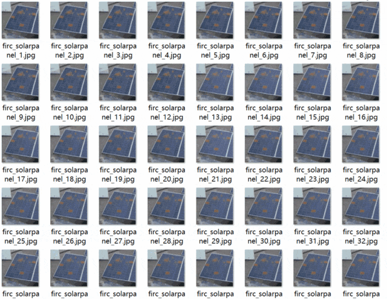

# [Dataset] [Object Detection] Solar Photovoltaic Panel Dust Accumulation Detection Dataset VOC+YOLO format with 1 category.

Dataset format: Pascal VOC format + YOLO format (txt file without split path, only containing jpg images and corresponding VOC format xml files and yolo format txt files)
Number of images (number of jpg files): 1463
Number of annotations (number of xml files): 1463
Number of annotations (number of txt files): 1463
Number of annotation categories: 1
Annotation category name: ["Dirt"]
Number of bounding boxes for each category:
- Dirt bounding box count = 6822
Total bounding box count: 6822
Using labelImg for annotation tool
Annotation rules: draw a rectangle around the category
Important note: The image repetition is very high, please refer to the image examples for specific details.
Special declaration: This dataset does not guarantee the accuracy or weights of the trained model or any other aspects, it only provides accurate and reasonable annotations.

Image example:

Annotation example:

## Payment

Here is a pay link on Stripe ( https://buy.stripe.com/3cs8yP7sY87d0vu9AB ). Please contact me lonlonago@foxmail.com after funding $89, and I will send you a complete data files , thank you!

